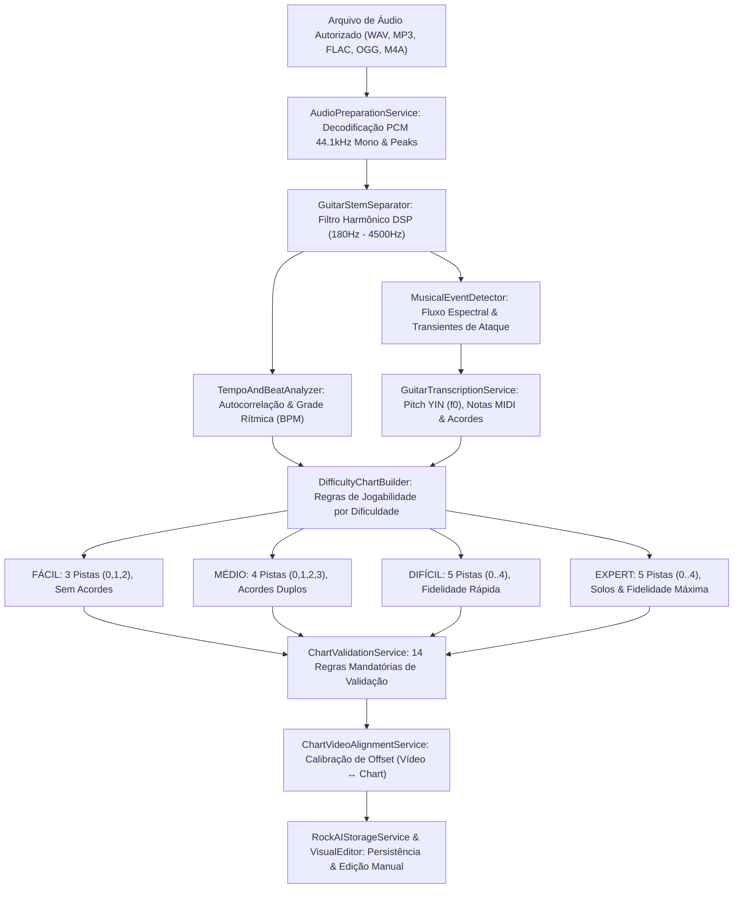

# ARQUITETURA TÉCNICA — ROCK AI AUTOCHART ENGINE
## ROCKBRAZIL V13.9
**Documento Técnico de Referência de Engenharia**

---

### 1. DIAGRAMA DO PIPELINE COMPLETO

---

### 2. PRINCÍPIOS DE ENGENHARIA E CONFORMIDADE
1. **Conformidade Legal & Termos da API:**
   - O RockBrazil não realiza web scraping nem extrai áudio de transmissões do YouTube.
   - O vídeo oficial do YouTube é executado unicamente através do player IFrame padrão (`youtubePlayer.ts`), atuando como referência audiovisual.
   - A geração de charts via IA requer o fornecimento direto do áudio pelo usuário ou desenvolvedor. Caso apenas o link seja inserido, o draft é cadastrado como `AGUARDANDO ÁUDIO AUTORIZADO`.
2. **Processamento DSP no Navegador:**
   - O pipeline opera inteiramente via Web Audio API e buffers tipados `Float32Array`.
   - O consumo de memória é mantido abaixo de 50MB por processamento com liberação determinística de referências.
3. **Escalabilidade para Modelos Deep Learning:**
   - O componente `GuitarStemSeparator` implementa a interface `StemSeparatorAdapter`.
   - Pode ser acoplado a backends externos (como Demucs / HTDemucs via WebAssembly ou microserviço ONNX) sem alterar as camadas de transcrição ou de validação de charts.

---

### 3. AS 14 REGRAS MANDATÓRIAS DO CHART VALIDATION SERVICE
1. **Timestamps Finitos e Válidos:** Todos os tempos de notas devem ser números finitos, não-nulos e $\ge 0$.
2. **Ordem Temporal Estritamente Crescente:** As notas devem estar ordenadas cronologicamente sem regressões.
3. **Pistas Válidas:** Notas no Fácil restritas a $0 \le \text{lane} \le 2$; no Médio a $0 \le \text{lane} \le 3$; no Difícil e Expert a $0 \le \text{lane} \le 4$.
4. **Ausência de Duplicatas Exatas:** Não podem existir duas notas idênticas na mesma pista e mesmo instante.
5. **Espaçamento Físico Mínimo:** Nenhuma nota na mesma pista pode ocorrer com intervalo menor que 50 ms.
6. **Durações Válidas:** Duração das notas deve ser $\ge 0$ (notas normais $= 0$; notas de sustentação $> 0$).
7. **Regras de Sustentação:** A cauda de sustentação (*sustain*) não pode ultrapassar o início da próxima nota na mesma pista.
8. **Restrições de Acordes por Dificuldade:** Fácil tem 0 acordes; Médio tem no máximo acordes de 2 notas; Difícil e Expert suportam acordes de até 3 notas.
9. **Progressão de Densidade Rítmica:** A densidade de notas por segundo deve respeitar a hierarquia $\text{FÁCIL} < \text{MÉDIO} < \text{DIFÍCIL} \le \text{EXPERT}$.
10. **Presença Mínima de Notas:** Nenhuma dificuldade gerada pode estar vazia se a música contiver guitarra detectada.
11. **Limite de Duração:** Nenhuma nota pode estar agendada após o término da faixa de áudio.
12. **Compatibilidade com o Game Engine:** Todo objeto de nota gerado possui as propriedades operacionais `id`, `hit: false`, `missed: false`, `sustainCompleted: false` e `sustainHeldTime: 0`.
13. **Compatibilidade com o Game Renderer:** Formato de coordenadas compatível com a projeção de esteira 3D em perspectiva.
14. **Compatibilidade com a Tela de Resultados:** Cálculo consistente de pontuação máxima, estrelas e porcentagem de acertos para a tela *SHOW FINALIZADO*.
