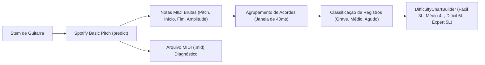

# GUIA TÉCNICO — SPOTIFY BASIC PITCH NO ROCKBRAZIL
## INTEGRAÇÃO COM MODELO NEURAL DE TRANSCRIÇÃO POLIFÔNICA

---

### 1. SOBRE O SPOTIFY BASIC PITCH
O **Spotify Basic Pitch** é um modelo de aprendizado profundo (Deep Learning) leve e de alta precisão desenvolvido pelo time de pesquisa de áudio do Spotify (ICASSP 2022).
- **Repositório Oficial:** `https://github.com/spotify/basic-pitch`
- **Documentação:** `https://basicpitch.spotify.com/`
- **Licença:** Apache 2.0 (Permissiva para uso em software e jogos).
- **Diferencial Crítico:** Ao contrário de algoritmos clássicos de detecção de pitch como YIN ou pYIN, o Basic Pitch suporta **polifonia**, permitindo transcrever acordes, múltiplos instrumentos de corda e bends expressivos com notas MIDI individuais.

---

### 2. ARQUITETURA NO ROCKBRAZIL
A integração com o Basic Pitch segue um fluxo em camadas:



#### Parâmetros de Inferência Recomendados:
- `onset_threshold`: `0.5` (Sensibilidade ao ataque da nota; valores maiores reduzem falsos positivos causados por ressonância da caixa da guitarra).
- `frame_threshold`: `0.3` (Limiar para manter notas de sustentação ativas).
- `minimum_note_length`: `50 ms` (Filtra harmônicos espúrios e ruídos de palheta).

---

### 3. FORMATO DOS EVENTOS GERADOS
Cada nota inferida pelo modelo é mapeada para a interface tipada:
```ts
export interface BasicPitchRawNote {
  pitchMidi: number;   // 40 (E2) a 88 (E6)
  startTime: number;   // Segundos com 4 casas decimais
  endTime: number;
  duration: number;
  confidence: number;  // 0.0 a 1.0 derivado da amplitude do modelo
  amplitude?: number;
}
```

---

### 4. DIAGNÓSTICO E EXPORTAÇÃO MIDI
O backend local salva o arquivo `.mid` padrão correspondente à transcrição antes de convertê-la em chart. O arquivo pode ser baixado ou importado em DAWs (como Reaper, Ableton ou FL Studio) para validação visual contra a forma de onda original.
