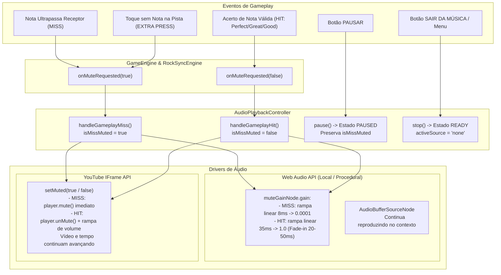

# RELATÓRIO OFICIAL DE ENGENHARIA — ROCKBRAZIL V13.9.5
## REGRA DEFINITIVA DE ÁUDIO NO MISS / HIT & ENCERRAMENTO DE SESSÃO

- **Projeto:** RockBrazil
- **Versão:** V13.9.5
- **Repositório:** `Daviidalmeida/RockBrazil`
- **Branch:** `main`
- **Ambiente de Produção:** [https://daviidalmeida.github.io/RockBrazil/](https://daviidalmeida.github.io/RockBrazil/)
- **Data de Implementação:** 31 de Outubro de 2026
- **Idioma Oficial:** Português Brasileiro

---

### 1. OBJETIVO E REGRA DEFINITIVA DE JOGABILIDADE

Implementação da mecânica clássica e definitiva de resposta auditiva no gameplay de ritmo (padrão consagrado da franquia Guitar Hero / Rock Band) para **todas as músicas do jogo**, tanto em áudio local (Web Audio API) quanto em streaming oficial do YouTube:

1. **No MISS (Nota Perdida ou Toque Extra):**
   - A música é silenciada **imediatamente**.
   - A reprodução continua avançando internamente (áudio não é pausado nem reiniciado).
   - A esteira (highway), a descida das notas e o relógio musical (`masterClock`) permanecem rigorosamente sincronizados e em movimento contínuo.
2. **Durante Sequência de MISS:**
   - Enquanto o jogador continuar errando, a música permanece estritamente muda.
   - Nenhuma temporizador ou rotina automática restaura o volume por conta própria.
3. **SOMENTE no HIT (Acerto Válido):**
   - O volume da música é restaurado.
   - Aplica-se um fade-in curto de **35 ms** (faixa de 20 a 50 ms) para evitar cliques ou transientes indesejados.
   - A música não é reiniciada nem sofre salto de posição temporal.
4. **Ausência de Novos Acertos:**
   - Se o jogador não acertar mais nenhuma nota, a música permanece muda até o fim da faixa ou até que o jogador saia da partida.
5. **Ação SAIR:**
   - Ao sair da partida (seja pelo menu de pausa "SAIR DA MÚSICA", pela tela de Game Over ou pelo botão de voltar), a reprodução é **completamente interrompida**, a sessão é encerrada e nenhuma música residual toca no menu.
6. **Distinção Estrita de Estados:**
   - **MISS:** Silencia o áudio sem parar o tempo.
   - **HIT:** Restaura o volume com fade-in curto (20-50 ms).
   - **PAUSE:** Pausa a partida, congelando a esteira e pausando o áudio.
   - **SAIR:** Encerra a reprodução e destrói a sessão de jogo.

---

### 2. ARQUITETURA TÉCNICA IMPLEMENTADA



---

### 3. COMPARAÇÃO DOS COMPONENTES ANTES E DEPOIS

| Componente | Comportamento Anterior (V13.9.3 - V13.9.4.1) | Novo Comportamento V13.9.5 (Regra Definitiva) |
| :--- | :--- | :--- |
| **`AudioPlaybackController.handleGameplayMiss`** | No-op deliberado (áudio não mutava em nenhum miss) | Silencia imediatamente a fonte ativa (`audio-buffer` ou `youtube`) |
| **`AudioPlaybackController.handleGameplayHit`** | No-op deliberado | Restaura o volume com fade-in suave de 20-50 ms |
| **`AudioManager.setMuteOnMiss`** | Transição de 25 ms genérica | Corte em 8 ms no MISS e fade-in de 35 ms no HIT |
| **`YouTubePlayerController.setMuted`** | `mute()` e `unMute()` diretos | `smoothFade = true` com escala de volume escalonada em 35 ms |
| **`Main.stopMatchSession`** | Desconexão parcial (apenas `audio.stop()`) | Encerramento unificado: `playbackController.stop()`, `audio.stop()`, `ytPlayer.stop()`, `masterClock.reset()` |
| **Menu de Pausa ("SAIR DA MÚSICA")** | Poderia manter fontes ativas em segundo plano | Destrói a sessão e garante silêncio absoluto no catálogo e no menu |

---

### 4. SUÍTE DE TESTES E COBERTURA DE REGRESSÃO

Criada a suíte dedicada [`tests/audioMissHitDefinitiveRule.test.ts`](file:///c:/Users/David/Downloads/RockBrazil/tests/audioMissHitDefinitiveRule.test.ts) cobrindo todos os cenários de transição exigidos:

1. **MISS no YouTube:** Silencia áudio imediatamente mantendo reprodução e relógio ativos.
2. **MISS no áudio local:** Aplica silenciamento no `muteGainNode` sem interromper o tempo de áudio.
3. **Múltiplos MISS consecutivos:** 50 erros em sequência mantêm a música muda sem pausar ou reiniciar.
4. **Ausência de temporizador:** Avanço temporal virtual de até 30s sem acertos mantém áudio estritamente mudo.
5. **HIT válido:** Restaura volume com fade-in de 20 a 50 ms sem reiniciar a música.
6. **Web Audio API fade-in:** Rampa linear de 35 ms (`linearRampToValueAtTime`) comprovada em teste unitário.
7. **Sem novos acertos:** A música permanece muda até o encerramento da partida.
8. **Integridade da esteira:** O MISS não altera o offset nem congela a esteira 3D.
9. **Ação SAIR:** Para completamente o áudio, encerra o player e reseta o estado.
10. **Distinção estrita:** MISS (silencia tempo correndo), HIT (desmuta), PAUSE (pausa tempo), SAIR (desliga tudo).
11. **Integração GameEngine:** Passagem de nota no threshold dispara `onMuteRequested(true)`.
12. **Toque extra:** Pressionamento em vazio (sem nota) dispara `onMuteRequested(true)`.
13. **Recuperação no acerto:** Acerto após erro dispara `onMuteRequested(false)` e reabilita o som.

### Resultados dos Testes Gerais:
```
Test Files  53 passed (53)
     Tests  682 passed (682)
  Duration  21.14s
```

* **TypeScript Compilation (`npx tsc --noEmit`):** 0 erros.
* **Production Build (`npm run build`):** Sucesso absoluto (dist gerado em 11.04s com isolamento de áudio comercial).
