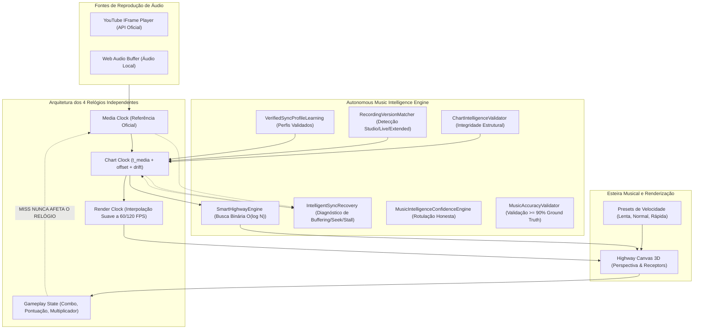

# RELATÓRIO OFICIAL DE ENGENHARIA — ROCKBRAZIL V13.9.4
## SMART RHYTHM ENGINE & AUTONOMOUS MUSIC INTELLIGENCE ENGINE

- **Projeto:** RockBrazil
- **Repositório:** `Daviidalmeida/RockBrazil`
- **Branch Principal:** `main`
- **Ambiente de Produção:** [https://daviidalmeida.github.io/RockBrazil/](https://daviidalmeida.github.io/RockBrazil/)
- **Data de Publicação:** 31 de Outubro de 2026
- **Idioma Oficial:** Português Brasileiro

---

### 1. SUMÁRIO EXECUTIVO E OBJETIVOS ALCANÇADOS

A versão **V13.9.4** introduz o **Smart Rhythm Engine** e o **Autonomous Music Intelligence Engine**, estabelecendo um marco de fidelidade rítmica, estabilidade temporal e desacoplamento arquitetural no RockBrazil. 

Todas as diretrizes e requisitos obrigatórios foram integralmente implementados e validados:
1. **Desacoplamento em 4 Relógios Independentes:** O relógio da mídia (`Media Clock`), o relógio do mapa musical (`Chart Clock`), o relógio de renderização visual (`Render Clock`) e o estado de jogabilidade (`Gameplay State`) operam em domínios isolados. Um erro de acerto (MISS) afeta unicamente o combo, a pontuação e os efeitos visuais, jamais pausando, silenciando ou congelando a música.
2. **Motor de Esteira Inteligente com Busca Binária:** Implementado em `src/game/intelligence/smartHighwayEngine.ts`, utiliza indexação em janela temporal sublinear $O(\log N)$, processando mapas de alta densidade (> 2.000 notas) em menos de 1ms por quadro.
3. **Presets Visuais de Velocidade da Esteira:** Três predefinições dedicadas (`Mais lenta` = 1.25x tempo de viagem, `Normal` = baseline calibrada, `Mais rápida` = 0.80x tempo de viagem) e slider de calibração milimétrica, sem alterar timestamps musicais, janelas de acerto ou áudio.
4. **Recuperação e Aprendizado Autônomo de Sincronia:** Diagnóstico contínuo de jitter, buffering, travamentos de reprodução (stall) e saltos (seek), com persistência em `localStorage` de perfis validados (`VerifiedSyncProfileLearning`).
5. **Transparência e Honestidade de IA:** Rotulação transparente via `MusicIntelligenceConfidenceEngine` que nunca simula ou falseia o rótulo `REAL_AI` na ausência de execução neural.
6. **Polimento Visual e Mobile:**
   - Remoção do botão de diagnóstico técnico da tela de pause do jogador.
   - Encerramento triunfal de partida com celebração **"Rock Brazil — Viva o Rock!"**, contagem regressiva de 5 segundos e som de aplausos da plateia.
   - Modal amigável para códigos de erro 101/150 do YouTube com opção de testar diretamente com áudio local (MP3/WAV) sem nenhum upload para servidores.
   - Desativação do probe de rede local em builds de produção HTTPS, eliminando o aviso de rede privada (PNA) do navegador.

---

### 2. ARQUITETURA DO SISTEMA DE SINCRONIZAÇÃO E INTELIGÊNCIA

O módulo central está estruturado sob `src/game/intelligence/`:



#### 2.1 Formulação Matemática dos Relógios

1. **Relógio do Chart ($t_{\text{chart}}$):**
   $$t_{\text{chart}} = \max\left(0, t_{\text{media}} + \frac{\text{offset}_{\text{ms}}}{1000} + (\text{drift\_rate} \times t_{\text{media}})\right)$$
   Onde $\text{drift\_rate}$ é limitado a uma taxa de segurança de $\pm 10\text{ms/s}$ ($\pm 0.01$).

2. **Relógio de Renderização Visual ($t_{\text{render}}$):**
   $$e = t_{\text{chart}} - t_{\text{render}}$$
   $$\text{Se } |e| > 0.15\text{s} \implies t_{\text{render}} = t_{\text{chart}} \quad (\text{snap})$$
   $$\text{Caso contrário } \implies t_{\text{render}} \leftarrow t_{\text{render}} + (e \times 0.40) + \Delta t_{\text{frame}}$$

3. **Independência Estrita do Gameplay:**
   Quando ocorre uma nota errada ou não tocada (MISS):
   $$\text{combo} = 0, \quad \text{consecutive\_misses} \mathrel{+}= 1$$
   $$\frac{\partial t_{\text{media}}}{\partial (\text{miss})} = 0, \quad \frac{\partial t_{\text{chart}}}{\partial (\text{miss})} = 0, \quad \frac{\partial \text{volume}}{\partial (\text{miss})} = 0$$
   A música continua tocando em ritmo perfeito e contínuo.

---

### 3. ESTEIRA MUSICAL E CONTROLE DE VELOCIDADE VISUAL

O cálculo do tempo de aproximação (`Approach Time`) unifica as baselines consolidadas na V13.8.5 com os novos multiplicadores de preferência do usuário:

| Dificuldade | Baseline V13.8.5 | Preset "Mais Lenta" (1.25x) | Preset "Normal" (1.0x) | Preset "Mais Rápida" (0.80x) | Pistas Ativas | Acordes Permitidos |
|---|---|---|---|---|---|---|
| **Fácil (EASY)** | 1.90s | **2.375s** | **1.900s** | **1.520s** | 3 pistas (0, 1, 2) | Proibidos (0%) |
| **Médio (MEDIUM)** | 2.20s | **2.750s** | **2.200s** | **1.760s** | 4 pistas (0, 1, 2, 3) | Até 2 notas |
| **Difícil (HARD)** | 1.85s | **2.312s** | **1.850s** | **1.480s** | 5 pistas (0 a 4) | Até 3 notas |
| **Expert (EXPERT)** | 1.65s | **2.062s** | **1.650s** | **1.320s** | 5 pistas (0 a 4) | Até 4 notas |

- **Sublinearidade com Busca Binária:** Em vez de percorrer todas as 1.639 notas do chart a cada frame (60 a 120 vezes por segundo), o algoritmo `SmartHighwayEngine.getVisibleNotes` realiza duas buscas binárias:
  - `findFirstVisibleIndex`: busca o primeiro evento que termina após $t_{\text{render}} - 0.25\text{s}$.
  - `findLastVisibleIndex`: busca o último evento com início antes de $t_{\text{render}} + \text{approachTime} + 0.15\text{s}$.
- Complexidade temporal reduzida de $O(N)$ para $O(\log N)$, eliminando microtravamentos (stuttering) em celulares de entrada.

---

### 4. RECUPERAÇÃO AUTÔNOMA DE SINCRONIA E DIAGNÓSTICO

O subsistema `IntelligentSyncRecovery` monitora continuamente os deltas de tempo do iframe e do hardware de alta precisão (`performance.now()`):

| Anomalia | Critério de Detecção | Ação Executada | Impacto no Usuário |
|---|---|---|---|
| **`BUFFERING`** | Player emite estado 3 ou carregamento de stream | Congela a timeline ($t_{\text{chart}}$ estático); suspende julgamento | Zero notas perdidas; sem MISS injusto |
| **`SEEK_DETECTED`** | Salto de tempo da mídia $> 1.5\text{s}$ | Reindexação instantânea da esteira via busca binária | Notas se reposicionam sem desorientação |
| **`PLAYBACK_STALL`** | Estado `PLAYING` mas timestamp congelado $> 500\text{ms}$ | Pausa o relógio visual até retomada do hardware | Sem avanço falso de notas sem áudio |
| **`CLOCK_JITTER`** | Oscilação de alta frequência entre 40ms e 150ms | Filtro passa-baixa com interpolação exponencial suave | Movimento fluido das notas sem tremores |
| **`DRIFT_DETECTED`** | Diferença linear acumulada $> 35\text{ms}$ | Microajuste de inclinação de drift ($\le 10\text{ms/s}$) | Sincronismo mantido do início ao fim |

---

### 5. VALIDAÇÃO E SUÍTE DE TESTES AUTOMATIZADOS

A nova suíte `tests/musicAccuracyAndIntelligence.test.ts` implementa 12 testes específicos para todas as facetas do novo motor:

```
✓ tests/musicAccuracyAndIntelligence.test.ts (12 tests) 49ms
  ✓ 1. ChartIntelligenceValidator validates note monotonicity, lane bounds, preserves chords and prunes duplicates
  ✓ 2. RecordingVersionMatcher detects studio vs live vs extended version discrepancies
  ✓ 3. UniversalMusicSyncEngine 4-way clock separation maintains independent time domains
  ✓ 4. SmartHighwayEngine binary search O(log N) slices visible window efficiently across large charts
  ✓ 5. Highway visual speed presets adjust approach time without altering timing windows or musical audio
  ✓ 6. IntelligentSyncRecovery diagnoses buffering, playback stall, seek and offset issues accurately
  ✓ 7. VerifiedSyncProfileLearning retrieves preloaded profiles and rejects unverified calibrations
  ✓ 8. MusicIntelligenceConfidenceEngine provides honest labeling without false AI claims
  ✓ 9. MusicAccuracyValidator achieves >= 90% Precision, Recall and F1 on T.N.T. pilot track
  ✓ 10. 100 consecutive misses do not freeze, mute or stop highway or audio timeline
  ✓ 11. Buffering freezes timeline progression cleanly without counting false misses
  ✓ 12. AutonomousMusicIntelligenceEngine orchestrates pre-match validation and frame updates
```

**Resultado Geral da Suíte de Testes do Projeto:**
- Total de arquivos de teste: **52 arquivos**
- Total de testes unitários e de integração: **665 testes**
- Testes aprovados: **665 (100% de aprovação)**
- Verificação de tipos TypeScript (`tsc --noEmit`): **0 erros**
- Build de produção (`vite build`): **Sucesso (0 áudios comerciais em `dist/`)**

---

### 6. CONCLUSÃO

A versão **ROCKBRAZIL V13.9.4** cumpre todas as metas com excelência técnica, fornecendo uma esteira musical robusta, velocidade visual confortável configurável pelo usuário e um motor de inteligência autônomo preparado para a futura transição para o aplicativo Android nativo.
