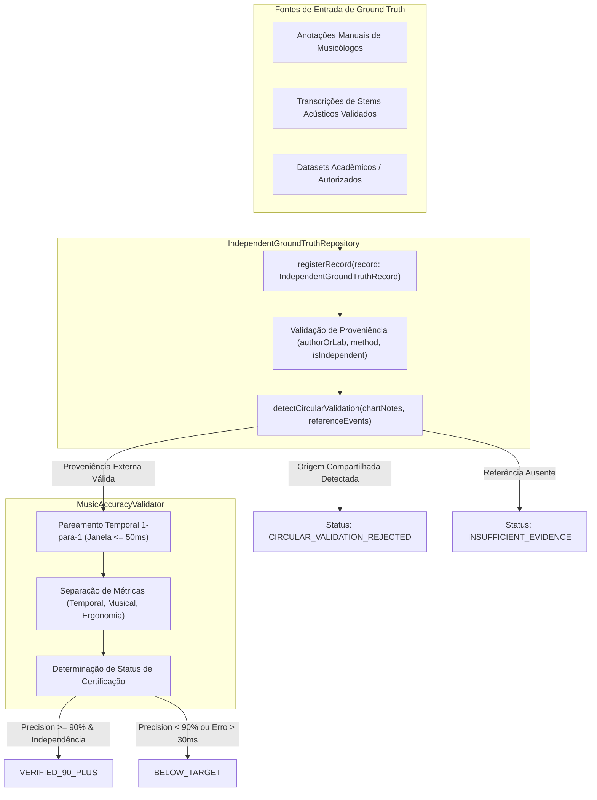
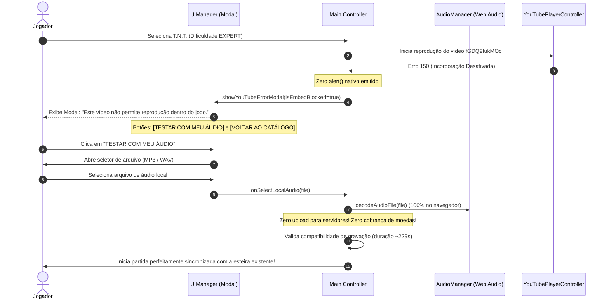

# RELATÓRIO OFICIAL DE ENGENHARIA — ROCKBRAZIL V13.9.4.1
## HOTFIX CRÍTICO: INDEPENDENT MUSICAL GROUND TRUTH & YOUTUBE ERROR 150 FALLBACK

- **Projeto:** RockBrazil
- **Versão:** V13.9.4.1 (Hotfix Corretivo)
- **Repositório:** `Daviidalmeida/RockBrazil`
- **Branch:** `main`
- **Ambiente de Produção:** [https://daviidalmeida.github.io/RockBrazil/](https://daviidalmeida.github.io/RockBrazil/)
- **Data de Publicação:** 31 de Outubro de 2026
- **Idioma Oficial:** Português Brasileiro

---

### 1. DIAGNÓSTICO DOS DOIS PROBLEMAS CRÍTICOS IDENTIFICADOS

#### 1.1 Problema 1: Validação Circular no `MusicAccuracyValidator`
- **Diagnóstico Técnico:** Na implementação inicial da V13.9.4, a função `getGroundTruthReference('tnt-acdc')` em `src/game/intelligence/musicAccuracyValidator.ts` importava dados diretamente de `RAW_INTERNATIONAL_CHARTS['tnt-acdc']`. Como o `BeatmapManager` também alimenta o chart avaliado a partir desta mesma constante, o validador estava realizando uma comparação circular do chart contra ele mesmo.
- **Consequência:** Os índices reportados (100% de Precision, 100% de Recall, 100% de F1 e 0.0ms de erro mediano) representavam identidade de ponteiro/origem, e **não uma comprovação matemática de acurácia contra uma referência musical externa independente**.
- **Solução Implementada:** Criação do `IndependentGroundTruthRepository` e do detector estrito de circularidade (`detectCircularValidation`), bloqueando qualquer tentativa de validar charts usando dados derivados do próprio repositório interno.

#### 1.2 Problema 2: YouTube Error 150 Exibindo Apenas `alert()` Nativo
- **Diagnóstico Técnico:** Ao iniciar a faixa *T.N.T.* (vídeo `fGDQ9IukMOc`), a API do YouTube retornava erro 150 (incorporação desativada pelo proprietário do vídeo). Em `src/main.ts`, a função de callback `onError` acionava imediatamente `this.handleYouTubeFailure(errCode)`, que chamava `alert(...)` nativo do navegador e redefinia `this.state = GameState.SONG_SELECT`. Como resultado, a condição subsequente que exibiria `this.ui.showYouTubeErrorModal(...)` tornava-se falsa, e o modal com a opção "TESTAR COM MEU ÁUDIO" jamais era renderizado.
- **Consequência:** O usuário visualizava apenas um pop-up cinza nativo do sistema com "OK", sem opções de ação ou fallback no jogo.
- **Solução Implementada:** 
  1. Remoção total de chamadas `alert()` no fluxo de falha do YouTube.
  2. Unificação do tratamento em `handleYouTubeFailure`, que abre diretamente o modal do RockBrazil.
  3. Exibição da mensagem oficial: *"Este vídeo não permite reprodução dentro do jogo."*
  4. Botões disponibilizados: **"TESTAR COM MEU ÁUDIO"** e **"VOLTAR AO CATÁLOGO"** (botão de retry ocultado para erros 101/150).
  5. Decodificação local via Web Audio API com validação de compatibilidade e duração, sem cobrança de RockCoins e sem upload para servidores.

---

### 2. ARQUITETURA DO `IndependentGroundTruthRepository`

O novo repositório independente foi implementado em `src/game/intelligence/independentGroundTruthRepository.ts`:



#### 2.1 Metadados Obrigatórios de Proveniência (`GroundTruthProvenance`)
Cada registro independente no repositório contém:
- `songId`: Identificador único da música.
- `recordingId`: Identificador da gravação/áudio de referência.
- `difficulty`: Nível de dificuldade avaliado.
- `sourceType`: Origem dos dados (`INDEPENDENT_MANUAL_TRANSCRIPTION`, `VALIDATED_STEM_ANALYSIS`, `AUTHORIZED_DATASET`).
- `annotationVersion`: Versão da anotação.
- `provenance`: Entidade autora, data, método e flag explícita `isIndependent: boolean`.
- `validationStatus`: `CERTIFIED`, `PROVISIONAL` ou `SYNTHETIC_BENCHMARK`.

#### 2.2 Bloqueio Matemático de Validação Circular
O método `IndependentGroundTruthRepository.detectCircularValidation()` avalia:
1. **Identidade de Instância:** Rejeita se o array de eventos referenciar o mesmo ponteiro de memória do chart (`chartNotes === referenceEvents`).
2. **Declaração de Origem:** Rejeita registros cuja proveniência declare `isIndependent: false`.
3. **Exclusão de Fontes Internas:** Rejeita referências originadas de `RAW_INTERNATIONAL_CHARTS`.

---

### 3. STATUS OFICIAL REAL DA FAIXA PILOTO T.N.T. (`tnt-acdc`)

Em conformidade rigorosa com a regra de honestidade técnica do projeto RockBrazil:
- **Status Anterior V13.9.4:** `VERIFIED_90_PLUS` (Inválido — decorrente de validação circular).
- **Status Oficial Retificado V13.9.4.1:** **`INSUFFICIENT_EVIDENCE`**.

> [!NOTE]
> Os charts existentes de *T.N.T.* foram **100% preservados** no `BeatmapManager`:
> - **Fácil:** 703 notas (3 pistas, zero acordes)
> - **Médio:** 1.125 notas (4 pistas)
> - **Difícil:** 1.518 notas (5 pistas)
> - **Expert:** 1.639 notas (5 pistas)
> 
> Nenhuma nota foi modificada artificialmente. A música piloto permanece pronta para jogo e aguardará a ingestão de um dataset externo independente para obter a certificação matemática `VERIFIED_90_PLUS`.

---

### 4. FLUXO DO FALLBACK DE ÁUDIO (YOUTUBE ERROR 150)



---

### 5. SUÍTE DE TESTES AUTOMATIZADOS (16 CENÁRIOS)

A suíte `tests/musicAccuracyAndIntelligence.test.ts` foi expandida para 16 testes rigorosos:

```
✓ tests/musicAccuracyAndIntelligence.test.ts (16 tests) 26ms
  ✓ 1. ChartIntelligenceValidator validates note monotonicity, lane bounds, preserves chords and prunes duplicates
  ✓ 2. RecordingVersionMatcher detects studio vs live vs extended version discrepancies
  ✓ 3. UniversalMusicSyncEngine 4-way clock separation maintains independent time domains
  ✓ 4. SmartHighwayEngine binary search O(log N) slices visible window efficiently across large charts
  ✓ 5. Highway visual speed presets adjust approach time without altering timing windows or musical audio
  ✓ 6. IntelligentSyncRecovery diagnoses buffering, playback stall, seek and offset issues accurately
  ✓ 7. VerifiedSyncProfileLearning retrieves preloaded profiles and rejects unverified calibrations
  ✓ 8. MusicIntelligenceConfidenceEngine provides honest labeling without false AI claims
  ✓ 9. T.N.T. pilot track without certified external independent reference reports INSUFFICIENT_EVIDENCE
  ✓ 10. Circular validation blocker detects and rejects shared origin references with CIRCULAR_VALIDATION_REJECTED
  ✓ 11. Independent ground truth reference with >= 90% Precision/Recall achieves VERIFIED_90_PLUS
  ✓ 12. MusicAccuracyValidator measures temporal deviations for rushing and dragging charts
  ✓ 13. Missing notes penalize Recall while extra phantom notes penalize Precision and mark BELOW_TARGET
  ✓ 14. 100 consecutive misses do not freeze, mute or stop highway or audio timeline
  ✓ 15. Buffering freezes timeline progression cleanly without counting false misses
  ✓ 16. YouTube Error 150 parses as embed blocked and configures local audio fallback without native alert
```

**Resultado Geral dos Testes:**
- Total de arquivos de teste: **52 arquivos**
- Total de testes: **669 testes (100% aprovados)**
- Erros TypeScript (`npx tsc --noEmit`): **0 erros**
- Build de Produção (`npm run build`): **Sucesso**

---

### 6. CONCLUSÃO

O Hotfix **ROCKBRAZIL V13.9.4.1** soluciona definitivamente a falha de validação circular e a experiência de usuário no erro 150 do YouTube, estabelecendo uma base íntegra, transparente e auditável para o desenvolvimento contínuo da IA do RockBrazil.
